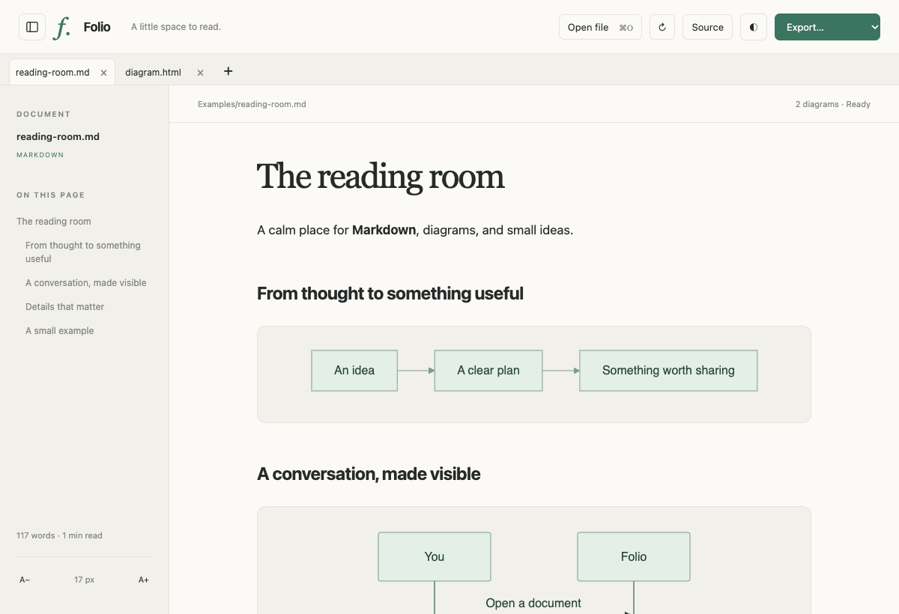
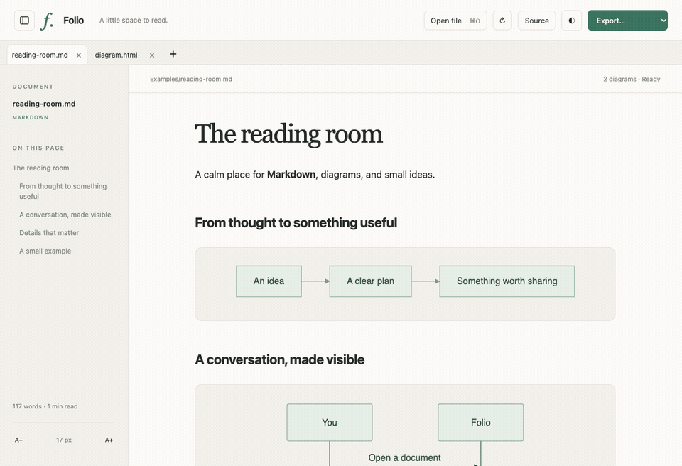
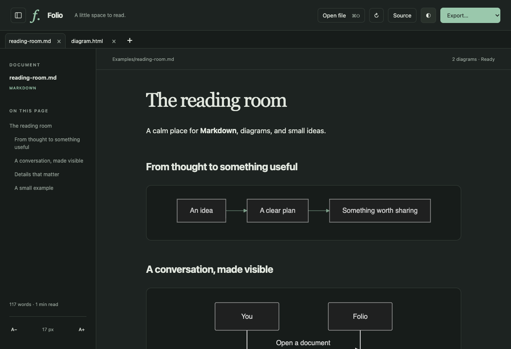
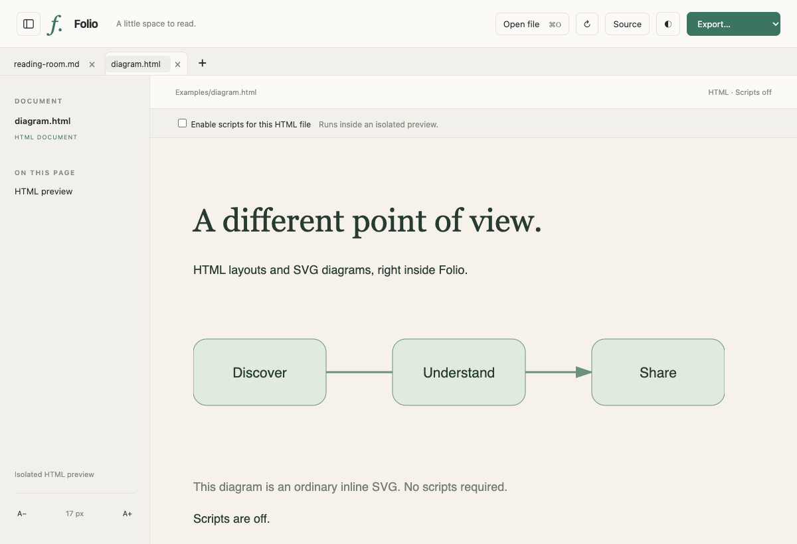

<p align="center">
  
</p>
<h1 align="center">Folio</h1>
<p align="center"><strong>A little space to read.</strong><br>Markdown, Mermaid, and HTML — together in a small native Mac app.</p>
<p align="center">
  <a href="https://github.com/abdulfatiraziz/folio/releases/latest"></a>
  
  <a href="LICENSE"></a>
</p>

<p align="center"><a href="https://github.com/abdulfatiraziz/folio/releases/latest"><strong>Download Folio for Mac →</strong></a></p>



Folio opens the files you already have. Read Markdown with rendered Mermaid diagrams, switch to an HTML layout in the next tab, and export what you need. No account, server, or Node.js runtime is required to use the app. Markdown and Mermaid rendering work offline.

## A quick look



*The demo and screenshots use Folio's bundled renderer with sample documents. The app wraps this interface in a native AppKit window with macOS file dialogs, menus, search, printing, and exports.*

## What it does

- **Markdown that reads well.** Headings, tables, checklists, code blocks, blockquotes, images, and sanitized inline HTML.
- **Diagrams next to your ideas.** Mermaid fenced blocks render as SVG using bundled libraries. Ordinary HTML/SVG diagrams work too.
- **Tabs across the top.** Open several files at once, switch between them, and keep each Markdown tab's reading position. Reopening a file selects its existing tab.
- **Your reading space.** Light and dark appearances, adjustable type, a collapsible heading sidebar, source alongside preview, and Find.
- **HTML when you need it.** Preview complete HTML documents. Scripts start off; an opt-in switch enables them inside an isolated iframe.
- **Edit and save.** Press **Edit** (⌘U) to type in the original Markdown or HTML with a live preview. Nothing is written until you press ⌘S, and Folio asks before closing a tab or quitting with unsaved changes.
- **Comments on your text.** Select words in the preview and click **Comment**. Comments are highlighted in the document, listed in a side panel, and saved inside the Markdown file as one hidden HTML comment block at the end, so they travel with the file and stay invisible in other Markdown viewers.
- **Safe with your originals.** Folio watches the active file for changes and reloads it, but never overwrites unsaved edits. Exports use a new filename and protect files open in tabs.
- **A small native host.** AppKit and the macOS WebKit engine, with no Electron runtime. The first release is approximately **4 MB installed** and **1.2 MB zipped**.

<details>
<summary><strong>More screenshots</strong></summary>

### Dark appearance



### HTML and SVG



</details>

## Install

1. Download **Folio.zip** from the [latest release](https://github.com/abdulfatiraziz/folio/releases/latest).
2. Unzip it and move **Folio.app** to **Applications**.
3. Open Folio, then choose a document with **⌘O** or drop files into its window.

**Requirements:** Apple Silicon Mac, macOS 14 Sonoma or later. Intel builds are not currently provided.

Release builds are **ad-hoc signed, not Apple-notarized**. macOS may require approval before opening a downloaded build. You can also build from source below. Folio does not change your default Markdown or HTML app.

## Tabs and keyboard shortcuts

Use **⌘O**, **⌘T**, or the **+** button to open files. Select multiple files in the Open dialog, or drop multiple documents into the window, to create several tabs. Tabs are kept for the current session; closing the last one returns to the welcome page.

| Action | Shortcut |
| --- | --- |
| New document | ⌘N |
| Open file(s) | ⌘O |
| Open file(s) in new tabs | ⌘T |
| Close current tab | ⌘W |
| Next / previous tab | ⌘⇧] / ⌘⇧[ |
| Toggle sidebar | ⌃⌘S |
| Toggle editor | ⌘U |
| Save / Save As | ⌘S / ⌘⇧S |
| Add comment on selected text | ⌘⌥M |
| Show / hide comments | ⌘⇧K |
| Switch appearance | ⌘D |
| Find | ⌘F |
| Reload current file | ⌘R |
| Larger / smaller text | ⌘+ / ⌘− |
| Export PDF | ⌘E |
| Print | ⌘P |

## Export your work

Use the **Export** dropdown or **File** menu. Exports apply to the selected tab.

| Format | What gets saved |
| --- | --- |
| **PDF** | A continuous page with rendered Markdown, diagrams, or HTML |
| **Print** | Native print dialog, with paginated printing and Save as PDF |
| **HTML** | Styled standalone HTML with embedded Mermaid SVGs for Markdown; original HTML for HTML input |
| **PNG** | A full document image, up to 30,000 CSS pixels tall |
| **Plain text** | Extracted document text |
| **Original source** | A separate copy of the Markdown or HTML source |
| **Diagram SVGs** | Each rendered Mermaid diagram as an individual SVG file |

PDF and PNG exports use a 1,000 CSS pixel layout width. Markdown HTML export attempts to embed local images; remote assets and HTML documents with external dependencies can still need their original locations. HTML exports re-render the source according to the script switch, rather than capturing transient interactive state. Asynchronously loaded JavaScript charts are not guaranteed to export their current state.

## Local files and HTML behavior

UTF-8 Markdown, text, and HTML files are supported. Relative assets can be read from the opened document's folder and subfolders; parent-relative paths and symlinks outside that folder are blocked. Each tab has its own asset base, so identical relative filenames in different folders resolve independently.

Markdown is sanitized with DOMPurify. HTML previews use an opaque-origin sandbox, with scripts off by default and no native bridge access. Enabling scripts allows that document's JavaScript and network requests inside the preview. Documents with remote images, CSS, fonts, or scripts may contact those remote hosts; offline rendering refers to the bundled Markdown and Mermaid engines.

## Build from source

Install [Xcode Command Line Tools](https://developer.apple.com/xcode/resources/) and Node.js **22 or newer**. Then:

```sh
git clone https://github.com/abdulfatiraziz/folio.git
cd folio
npm ci
npm run build
```

The build prints the path to **Folio.app** and creates **dist/Folio.zip**. The app bundle is staged under the system temporary directory to avoid external-volume metadata interfering with code signing. Set `FOLIO_BUILD_DIR` to choose a different staging directory. The compiled app needs neither Node.js nor npm.

### Tests

```sh
npm run bundle
npm test
```

Tests use an installed Google Chrome by default. To use Playwright's Chromium instead:

```sh
npx playwright install chromium
FOLIO_TEST_BROWSER=chromium npm test
```

The suite covers Mermaid/SVG rendering, malformed diagrams, Markdown sanitization, HTML script isolation, tabs, reading-position restoration, and selected-document exports. A [GitHub Actions template](docs/github-actions.yml) is included for Linux renderer tests and a macOS build. To enable it, copy it to `.github/workflows/check.yml` using GitHub or a token with the `workflow` scope.

For native integration checks, use the app path printed by the build:

```sh
"/path/to/Folio.app/Contents/MacOS/Folio" \
  --smoke "$PWD/examples/reading-room.md" \
  --tab-check "$PWD/examples/diagram.html" \
  --out "$PWD/evidence/smoke-tabs"
```

This launches the actual app, checks its tab lifecycle, and writes screenshots, PDF, PNG, HTML, and text outputs. `evidence/` is ignored by Git.

### Refresh the screenshots and GIF

With Google Chrome and [FFmpeg](https://ffmpeg.org/) installed:

```sh
npm run bundle
npm run media
```

This captures the actual renderer using only the public examples in this repository. Set `FOLIO_TEST_BROWSER=chromium` to use Playwright's browser.

## Project layout

```text
Sources/Folio.swift       Native window, menus, tabs, files, and exports
web/                      Reader interface and document rendering
scripts/                  Build, license notices, icon, and media tooling
tests/                    Renderer integration tests
examples/                 Sample Markdown and HTML documents
docs/assets/              README screenshots and demo GIF
```

## Contributing and credits

Issues and pull requests are welcome. See [CONTRIBUTING.md](CONTRIBUTING.md) to get started.

Built with [Swift/AppKit](https://developer.apple.com/documentation/appkit), [WebKit](https://webkit.org/), [Marked](https://github.com/markedjs/marked), [DOMPurify](https://github.com/cure53/DOMPurify), and [Mermaid](https://github.com/mermaid-js/mermaid). Runtime dependency notices are generated into [THIRD-PARTY-LICENSES.txt](THIRD-PARTY-LICENSES.txt) and included in the app.

[REA](https://github.com/morluto/rea) was used for read-only inspection of a local reference reader during initial development. Folio is an independent implementation; no proprietary reference-app code or assets are included. REA is not a runtime dependency.

## License

[MIT](LICENSE) © 2026 Abdul Fatir Aziz.
