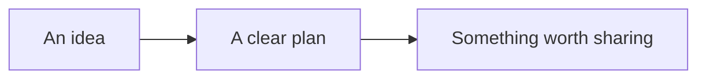
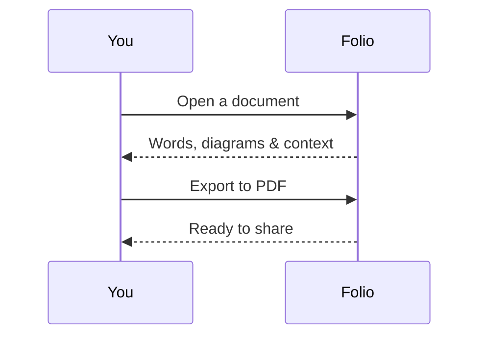

# The reading room

A calm place for **Markdown**, diagrams, and small ideas.

## From thought to something useful



## A conversation, made visible



## Details that matter

| Format | What you get |
| --- | --- |
| Markdown | Tables, lists, images & diagrams |
| HTML | Your own layouts and SVG artwork |
| Export | PDF, HTML, PNG, text & SVG |

- [x] Keep files local
- [x] Render diagrams offline
- [ ] Read something new

> Make room for the ideas you want to keep.

## A small example

```javascript
const idea = { clear: true, readyToShare: true };
```

[Open the HTML example](diagram.html)
